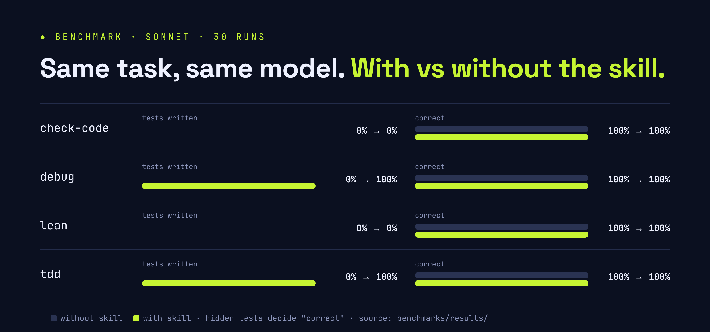

# Glossary

Every skill, what it is for, and what it measurably changes. Call a skill by name (`/master-your-skills:<name>`) or just describe the task; `start` routes vague requests.

## Measured gains

Same task and model, run with and without the skill; hidden tests decide "correct". Skills not in this table have not been benchmarked yet.

<!-- gains:start -->
| Skill | Runs | Correct (without → with) | Wrote a test | Output tokens |
|---|---|---|---|---|
| `check-code` | 3+3 | 100% → 100% | 0% → 0% | +33% |
| `debug` | 3+3 | 100% → 100% | 0% → 100% | +90% |
| `lean` | 6+6 | 100% → 100% | 0% → 0% | +15% |
| `tdd` | 3+3 | 100% → 100% | 0% → 100% | +290% |
<!-- gains:end -->

## All skills

### Start

| Skill | Use it for |
|---|---|
| `start` | Entry point. Picks the right skills for a request and turns a vague ask into a confirmed brief with one round of questions, each with a suggested answer. Use at the start of work, or when the user says "I want to build", "help me with", "where do I start", "which skill". |

### Always on

| Skill | Use it for |
|---|---|
| `lean` | Always-on base for coding work. Solve the whole task with the least new code, touch only what the task needs, and end by saying what was skipped. Use on any write, fix or refactor, and when the user says "keep it simple", "yagni", "too much code", "over-engineered". |

### Define

| Skill | Use it for |
|---|---|
| `spec` | Write a short spec before building new or unclear work, and get it approved before any code. Use for a new feature, project or significant change, a vague requirement, or when the user says "write a spec", "PRD", "requirements", "scope this", "what exactly are we building". |
| `plan-work` | Break an approved spec or clear request into ordered, vertical-slice tasks, each with acceptance checks, a verify command and its blockers. Use when the user says "plan this", "break it down", "make tickets", "task list", or when work is too big to start in one go. |
| `prototype` | Build a throwaway prototype that answers one design question, then keep the answer and bin the code. Use when someone asks "will this state model hold up?", "what should this page look like?", wants to try a few layouts, or wants to click through logic before building it for real. |

### Design

| Skill | Use it for |
|---|---|
| `api-design` | Design or change an interface other code depends on: REST or GraphQL endpoints, module contracts, component props, event payloads. Covers types, errors, validation, pagination, safe retries and versioning. Use for "design an API", "add an endpoint", "change this contract", "is this breaking". |
| `design-code` | Shape or reshape code structure so each module hides a lot behind a small interface. Use for "improve the architecture", "this code is hard to change", "where should this boundary go", "make it testable", "clean up / simplify this module", or before adding a new layer or abstraction. |

### Build

| Skill | Use it for |
|---|---|
| `frontend-ui` | Build or change user-facing UI that looks deliberate, not AI-generated. Use when making a page, screen, component, form, dashboard or landing page, when picking colors, fonts or spacing, or when someone says the UI "looks generic" or "looks like AI". |
| `build` | Implement a plan or ticket in small working slices, each one tested, verified and committed before the next. Use when the user says "implement this", "build the plan", "do task 3", "work through the tickets", or a change will touch more than one file. |
| `tdd` | Write the failing test first, then the code, one behavior at a time, with tests that catch real bugs. Use when the user says "TDD", "test first", "red-green", "add tests", or when you implement logic, fix a bug, or change behavior. |
| `parallel` | Split work across parallel subagents and merge the results safely. Use when the user says "run these in parallel", "fan out", "use subagents", "spin up a team", or when a task has several independent parts (separate bugs, modules, files, questions) that could run at the same time. |
| `context-diet` | Load the least context that gets the task right. Use when starting a session or new task, when answers drift or invent APIs, before writing code against a versioned library, when the conversation is long or "context is full", or to write a handoff note so a fresh session can continue. |

### Verify

| Skill | Use it for |
|---|---|
| `debug` | Find the root cause of a bug with a fast repro loop, fix it once, and lock it with a test. Use when something is broken, throws, fails, is flaky or slow, when a test or build goes red, or the user says "debug", "why does this fail", "it worked yesterday". |
| `check-code` | Review a change for bugs, security, load, missing tests, speed and needless code, with ranked findings in plain words. Use when the user says "check this", "review my PR", "review the last commit", "is this ready to merge", "is this over-engineered", or before merging any change. |
| `browser-test` | Check a web change in a real browser: console, network, DOM, accessibility tree, screenshots. Use when a UI change needs proof it works, a page renders or behaves wrong, or when asked to "open it in the browser", "take a screenshot", "check the console" or "write a Playwright test". |
| `accessibility` | Audit an existing page or component against WCAG 2.2 AA and fix what fails. Use for an accessibility or a11y audit, running axe or pa11y, triaging a11y violations, or when "screen reader can't read this", "keyboard doesn't work" or "contrast is too low" comes up. |
| `performance` | Make something measurably faster: measure, find the bottleneck, fix it, re-measure, keep or revert. Use when a page, endpoint, query, build or script is slow, Core Web Vitals (LCP, INP, CLS) fail, latency regressed, or someone says "speed this up" or "why is this slow". |
| `security` | Find and close security holes where untrusted data enters the code. Use when code handles user input, login, sessions, permissions, uploads, webhooks, server-side fetches, secrets, personal data, LLM output or new dependencies, or when asked "is this safe" or to harden it. |
| `audit` | Read-only health check of a repo or folder: defects, security gaps, scaling limits, untested risky logic, slow spots, dead weight, and a ledger of `shortcut:` debt markers. Use for "audit this repo", "what can I delete", "list the shortcuts", "tech debt". |
| `quality-bar` | Write the project's quality bar once in CONSTRAINTS.md with real commands and numbers, then refuse any change that quietly lowers it (skipped tests, ts-ignore, eslint-disable, removed asserts, lowered thresholds, stubs). Use for "set our standards", "add quality gates", "stop the agent cheating to green". |

### Ship

| Skill | Use it for |
|---|---|
| `git` | Turn work into clean git history and reviewable pull requests. Use when committing, writing a commit message, splitting a messy working tree into commits, naming or cleaning up branches, opening or describing a PR, tagging a release, picking a version bump or writing a changelog entry. |
| `ship` | Get a change to production safely and keep it healthy. Use when deploying or launching, asking "is this ready to ship?", setting up CI gates, planning a staged rollout or rollback, adding logs/metrics/alerts, or removing an old API, feature or database column. |
| `docs` | Write down decisions and domain terms so they stay true. Use when recording an architecture decision (ADR), defining or settling project vocabulary (GLOSSARY.md), updating a README or API docs after a change, or checking whether a doc is stale or "out of date" with the code. |
