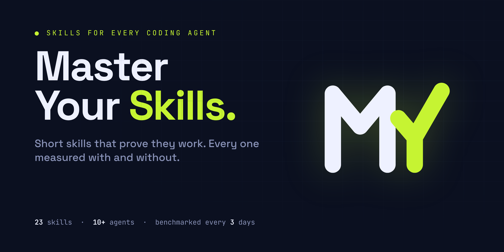
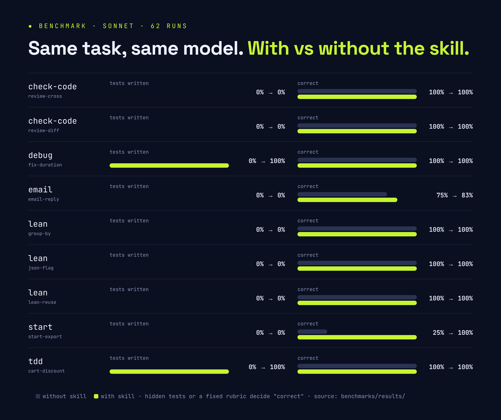

<p align="center">
  
</p>
<h1 align="center">Master Your Skills</h1>
<p align="center"><em>Short skills for coding and office work. Each one proves it works.</em></p>
<p align="center">
  <a href="LICENSE"></a>
  <a href="GLOSSARY.md"></a>
  <a href="benchmarks/results/"></a>
  
  
</p>
<p align="center">
  <a href="#install-in-3-minutes">Install</a> ·
  <a href="#does-it-work">Benchmark</a> ·
  <a href="GLOSSARY.md">All skills</a> ·
  <a href="docs/AUDIT.md">Source audit</a> ·
  <a href="#faq">FAQ</a>
</p>
<p align="center"></p>

**What is this?** A set of instructions ("skills") that make AI agents work like a careful senior colleague. For code: ask the right questions, write less code, test what matters, find the real cause of bugs. For the office: speeches, company decks, emails that sound human, briefs, minutes, plans and procedures, without invented facts. Each skill is under 500 words, so it costs few tokens, and each one is measured with and without it on the same task.

## Install in 3 minutes

You need an AI coding agent already installed: Claude Code, Codex, Cursor, GitHub Copilot, Gemini CLI, Windsurf, OpenCode, Cline, Kiro or similar.

### Option 1: any agent (recommended)

1. Install **Node.js** (the "LTS" button) from [nodejs.org](https://nodejs.org) if you don't have it. Click next until it finishes.
2. Open a terminal:
   - **Windows:** press the Windows key, type `PowerShell`, press Enter.
   - **Mac:** press Cmd + Space, type `Terminal`, press Enter.
3. Go to your project folder. Example: `cd C:\Users\you\Desktop\my-project` (Windows) or `cd ~/my-project` (Mac).
4. Paste this and press Enter:
   ```
   npx skills add skydoy/Master-Your-Skills
   ```
5. When it asks which agents, pick yours with the arrow keys and Space, then Enter. Done.

### Option 2: Claude Code plugin (updates itself)

Inside Claude Code, type these two lines, one at a time:
```
/plugin marketplace add skydoy/Master-Your-Skills
/plugin install master-your-skills@master-your-skills
```

### Option 3: just the rules file

Download [`AGENTS.md`](https://raw.githubusercontent.com/skydoy/Master-Your-Skills/main/AGENTS.md) (right click, "Save link as") into your project folder. Then rename it if your agent needs another name:

| Agent | Save the rules file as |
|---|---|
| Codex, Cursor, Windsurf, OpenCode, Zed, Amp, GitHub Copilot coding agent | `AGENTS.md` (no change) |
| GitHub Copilot in VS Code / Visual Studio | `.github/copilot-instructions.md` |
| Claude Code | `CLAUDE.md` (or `~/.claude/CLAUDE.md` for every project) |
| Gemini CLI | `GEMINI.md` |
| Cline | `.clinerules/master-your-skills.md` |
| Kiro | `.kiro/steering/master-your-skills.md` |
| Any other agent | paste the contents into its "rules" or "custom instructions" setting |

### Option 4: claude.ai or the Claude app (no coding)

1. Open the [`dist/`](dist/) folder and download the skill you want, for example `email.zip` (click it, then "Download raw file").
2. In Claude, go to **Settings → Capabilities → Skills → Upload skill** and pick the `.zip`.
3. Start a chat and ask, for example: "email: reply to this…".

### Check it works

Ask your agent: **"start: I want to add a login page"**. It should come back with a few numbered questions, each with a suggested answer, before writing any code.

## Does it work?



Honest results so far (Sonnet, 9 tasks, 3 to 4 runs per arm; hidden tests, or a fixed rubric graded by a judge that sees the same sources):

- **`start`** turns a vague ask ("add an export for the sales report") into the right result: **25% → 100%** correct, because it asks first instead of guessing. It costs about twice the output tokens.
- **`tdd` and `debug`** make the agent leave a regression test every time (**0% → 100%**), with the same correctness. They cost more tokens, because tests are extra work.
- **`email`**: 75% → 83% on a reply graded for answering every question, inventing nothing and sounding human. Too few runs to call it a win yet.
- **`lean` and `check-code`** match the baseline: Sonnet already gets these tasks right without help. We keep looking for tasks hard enough to separate them, and will say so if they never do.

Full numbers per skill: [GLOSSARY.md](GLOSSARY.md). Raw runs: [`benchmarks/results/`](benchmarks/results/). Reproduce: `python3 benchmarks/run.py 3 sonnet` (one task: `BENCH_TASKS=start-export python3 benchmarks/run.py 3 sonnet`).

## The skills

### Coding skills

| Phase | Skills |
|---|---|
| Start | `start` (turns a vague ask into a complete brief) |
| Always on | `lean` |
| Define | `spec` · `plan-work` · `prototype` |
| Design | `api-design` · `design-code` |
| Build | `build` · `tdd` · `frontend-ui` · `parallel` · `context-diet` |
| Verify | `debug` · `check-code` · `browser-test` · `accessibility` · `performance` · `security` · `audit` · `quality-bar` |
| Ship | `git` · `ship` · `docs` |

### Office skills

Each works in two modes: **Direct** (paste everything, get the result) or **Guided** (one round of questions, each with a suggested answer, so "ok" accepts them all). Missing facts show as `[VALUE]`, never invented.

| For | Skills |
|---|---|
| Write and present | `speech` · `deck` (uses your company template) · `email` (new or reply, sounds like you) |
| Leaders | `exec-brief` · `decision` · `board-pack` · `okr` · `crisis-comms` |
| Managers | `meeting` · `weekly-status` · `feedback-review` · `project-plan` · `delegate` |
| Everyday work | `sop` · `summarize-doc` · `clear-request` · `spreadsheet-help` · `plan-my-day` |

Try it: **"email: reply to this, say the delivery moved to 12 March"** and paste the email.

What each one does, when to use it, and its measured gain: **[GLOSSARY.md](GLOSSARY.md)**.

## Why this repo

We audited 11 popular skill and agent repos ([docs/AUDIT.md](docs/AUDIT.md)). Most are 20,000 to 1,000,000 words, and only one measures results with and without its skill. Here the rules are:

1. **Measured, not promised.** A number appears in this README only if a results file backs it.
2. **Short.** One read per skill. Extra detail sits in a `reference.md` that loads only when needed.
3. **One skill per job.** No duplicates, no name clashes with built-in commands.
4. **Updated every 3 days.** Skills are re-checked, improved, and re-benchmarked; charts regenerate from the results.


## FAQ

**Will it cost more tokens?** Each skill loads only when it is needed and is under 500 words. Skills that add tests (`tdd`, `debug`) do spend more, because writing a test is extra work; the benchmark shows how much.

**How do I update?** Option 1: run the same `npx skills add` command again. Option 2: it updates itself. Option 3: download the file again.

**How do I remove it?** Option 1: `npx skills remove`. Option 2: `/plugin uninstall master-your-skills`. Option 3: delete the file.

**Can I change a skill?** Yes. Each one is a plain text file in `skills/<name>/SKILL.md`.

## License

MIT. All skill text in this repository is original.
