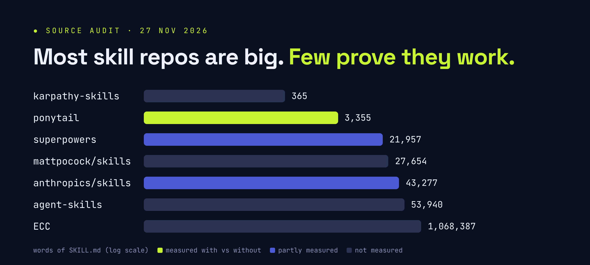

# Source audit (27 Nov 2026)

What each popular skills repo promises and what it can prove. Numbers come from each repo's own files.

## Summary

**Only 1 of 11 sources measures results with and without its skill (ponytail), and none proves the code gets more correct.** Almost all are large (20,000 to 1,000,000 words) and quote numbers without measurement. That is where Master Your Skills competes: short skills with measured gains.

| Source | License | Skills | Words | Promises | Proves |
|---|---|---|---|---|---|
| ponytail | MIT | 6 | 3,355 | -53% code, -45% tokens, -26% cost | Yes: 39 tasks × 5 runs, Opus only. Correctness same as without (87/90 vs 86/90) |
| agent-skills | MIT | 26 | 53,940 | "production-grade", spec → ship | Only structure and skill-selection tests (lexical). No with/without results |
| mattpocock/skills | MIT | 39 | 27,654 | "real engineering", 30 s setup | Nothing measured. Per-repo setup required |
| superpowers | MIT | 15 | 21,957 | full methodology, hours of autonomy | 1 task: -37% tokens. Evals in a separate repo |
| ECC | MIT | 328 (+translations) | ~1,068,000 | "-60% cost", "80% of tasks" | 566 structure tests; no outcome numbers |
| karpathy-skills | MIT (no file) | 1 | 365 | better behaviour from 4 rules | Nothing measured. Very easy to use |
| anthropics/skills | Apache-2.0* | 19 | 43,277 | reference skills | With/without eval tool (skill-creator), no published results |
| ui-ux-pro-max | MIT | 1 + data | n/a | 80 styles, 194 palettes | Counts verifiable; quality not measured |
| graphify | Apache-2.0 | tool | n/a | code graph, less reading | Own benchmarks (82% vs 70.8% grep, n=6) |
| cc-switch | MIT | app | n/a | switch provider in one click | App tests; not a skills repo |
| dify | modified Apache | platform | n/a | AI apps | Not reusable (commercial restrictions) |

\* `doc-coauthoring` has no license: not used.

## 20 improvements for Master Your Skills

**Proof**
1. Publish a with/without benchmark for every skill: at least 5 runs per task, with a confidence interval.
2. Measure correctness (hidden tests, planted bugs), not only size and tokens.
3. Run on 3 models (Opus, Sonnet, Haiku), not just one.
4. Numbers in the README only with a link to the results file.
5. A new skill gets in only with an observed failure and a test that shows it; rejected changes are logged.

**Fewer tokens**
6. Each SKILL.md at most 500 words; the rest in files read only when needed.
7. Merge duplicates: from 59 to about 25 skills (TDD, review, debugging, interviewing and other repeats).
8. Heavy knowledge (design, slide styles) in searchable CSV tables, not prose.
9. A context skill: read the glossary or code graph first instead of opening file after file.

**Easy to use**
10. One-command install in Claude Code and one .zip per skill for claude.ai.
11. One entry skill, `start`, that picks the right skill for the request.
12. Descriptions written as triggers (what + when) and tested to fire on their own.
13. No names that clash with built-in Claude Code commands (the old `/review` did).
14. One source file generates AGENTS.md, CLAUDE.md and Cursor rules, no hand copies.
15. Short README without hype; a glossary with each skill's measured gain.

**New capabilities**
16. Office skills with Guided and Direct modes (speech, deck, email and 15 by role).
17. Decks with a mandatory check: render, empty placeholders, fonts and minimum font size.
18. A `parallel` skill: parallel agents only without shared state, writes in separate worktrees, two-stage review.
19. Human approval only where it counts (spec and plan on large work).
20. Automatic GitHub checks (frontmatter, size, links, install test) on every change.
