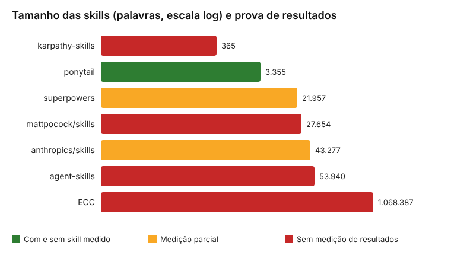

# Auditoria das fontes (27-11-2026)

O que cada repositório promete e o que consegue provar. Os números vêm dos ficheiros de
cada repositório; nenhum benchmark foi corrido por nós ainda.

## Resumo

**Só 1 em 11 fontes mede o resultado com e sem a skill (ponytail), e nenhuma prova que o código
fica mais correto.** Quase todas são grandes (20 mil a 1 milhão de palavras) e vendem números
sem medição. É aqui que o Master Your Skills pode ganhar: skills curtas, com ganho medido.

| Fonte | Licença | Skills | Palavras | O que promete | O que prova |
|---|---|---|---|---|---|
| ponytail | MIT | 6 | 3.355 | -53% código, -45% tokens, -26% custo | Sim: 39 tarefas × 5 corridas, só Opus. Correção igual ao sem skill (87/90 vs 86/90) |
| agent-skills | MIT | 26 | 53.940 | "production-grade", spec → ship | Só testes de estrutura e de escolha de skill (lexical). Sem resultados com/sem |
| mattpocock/skills | MIT | 39 | 27.654 | "real engineering", setup em 30 s | Nada medido. Setup obrigatório por repositório |
| superpowers | MIT | 15 | 21.957 | metodologia completa, horas autónomo | 1 tarefa: -37% tokens. Evals num repositório à parte |
| ECC | MIT | 328 (+traduções) | ~1.068.000 | "-60% custo", "80% das tarefas" | 566 testes de estrutura; nenhum número de resultado |
| karpathy-skills | MIT (sem ficheiro) | 1 | 365 | melhor comportamento com 4 regras | Nada medido. Muito fácil de usar |
| anthropics/skills | Apache-2.0* | 19 | 43.277 | skills de referência | Ferramenta de eval com/sem (skill-creator), sem resultados publicados |
| ui-ux-pro-max | MIT | 1 + dados | n/a | 80 estilos, 194 paletas | Contagens verificáveis; qualidade não medida |
| graphify | Apache-2.0 | ferramenta | n/a | grafo de código, menos leitura | Benchmarks próprios (82% vs 70,8% grep, n=6) |
| cc-switch | MIT | app | n/a | trocar de fornecedor num clique | Testes da app; não é de skills |
| dify | Apache modificada | plataforma | n/a | apps de IA | Não reutilizável (restrições comerciais) |

\* `doc-coauthoring` não tem licença: não usar.

## 20 melhorias para o Master Your Skills

**Prova**
1. Benchmark com e sem cada skill, publicado: pelo menos 5 corridas por tarefa, com intervalo de confiança.
2. Medir correção (testes escondidos, bugs injetados), não só tamanho e tokens.
3. Correr em 3 modelos (Opus, Sonnet, Haiku), não só num.
4. Números no README só com link para o ficheiro de resultados.
5. Uma skill nova só entra com uma falha observada e um teste que a mostre; mudanças rejeitadas ficam registadas.

**Menos tokens**
6. Cada SKILL.md com no máximo 500 palavras; o resto em ficheiros que só se leem quando é preciso.
7. Fundir duplicados: de 59 para cerca de 25 skills (TDD, revisão, debugging, entrevista e outras repetidas).
8. Conhecimento pesado (design, estilos de PPT) em tabelas CSV pesquisáveis, não em texto.
9. Skill de contexto: ler primeiro o glossário ou o grafo de código, em vez de abrir ficheiro a ficheiro.

**Fácil de usar**
10. Instalação num comando no Claude Code e um .zip por skill para o claude.ai.
11. Uma skill de entrada, `comecar`, que escolhe a skill certa para o pedido.
12. Descrições escritas como gatilho (o quê + quando) e testadas para ativarem sozinhas.
13. Sem nomes que colidam com comandos do Claude Code (o `/review` atual colide).
14. Um só ficheiro fonte gera AGENTS.md, CLAUDE.md e regras para Cursor, sem cópias à mão.
15. README curto e sem publicidade; glossário com o ganho medido de cada skill.

**Novas capacidades**
16. Skills de escritório com modo guiado e modo direto (discurso, PPT, email e as 15 por nível).
17. PPT com verificação obrigatória: render, placeholders vazios, fontes e tamanho mínimo de letra.
18. Skill `paralelo`: agentes em paralelo só sem estado partilhado, escrita em worktrees separadas, revisão em 2 fases.
19. Aprovação humana só nos pontos que contam (spec e plano em trabalho grande).
20. Validação automática no GitHub (frontmatter, tamanho, links, teste de instalação) a cada alteração.
